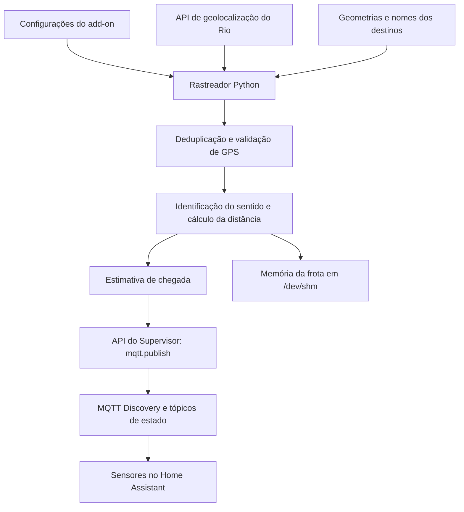

# Rastreador de Ônibus do Rio de Janeiro para Home Assistant

> Monitoramento de veículos de ônibus e BRT usando dados de geolocalização da cidade do Rio de Janeiro, estimativa de chegada a um ponto de referência e integração automática ao Home Assistant por MQTT Discovery.

## Visão geral

Este projeto é um rastreador de ônibus desenvolvido em **Python** para funcionar no ambiente de um **add-on do Home Assistant**. Ele consulta periodicamente uma API centralizada de geolocalização dos veículos, processa suas posições e publica os resultados em sensores MQTT do Home Assistant.

Para linhas com uma geometria de rota cadastrada, o sistema projeta a posição do ônibus sobre a rota (*map matching*) para identificar seu progresso e calcular a distância restante até um ponto configurado. Quando não existe geometria cadastrada, mas a API informa o sentido da viagem, o sistema pode utilizar uma estimativa baseada na distância em linha reta, ajustada por um fator de curvas.

**Objetivo:** permitir que o usuário acompanhe a posição, o sentido e o tempo **estimado** de chegada dos ônibus de interesse diretamente no Home Assistant, usando os dados disponíveis na fonte externa.

> **Escopo deste README:** a documentação foi elaborada a partir de `onibus.py`. Os arquivos `rotas_onibus.py`, `mapa_destinos.py` e o empacotamento do add-on não foram fornecidos; onde necessário, são apresentados formatos ilustrativos, não o conteúdo real desses arquivos.

## Funcionalidades

- Consulta de posições de ônibus convencionais (**SPPO**) e **BRT** por uma API centralizada.
- Monitoramento de linhas escolhidas nas opções do add-on.
- Consulta do minuto UTC atual e do minuto anterior para obter registros recentes.
- Suporte a paginação por cursor e respostas compactadas com Gzip.
- Eliminação de posições duplicadas de um mesmo veículo, mantendo a posição mais recente identificada.
- Descarte de coordenadas inválidas e registros de GPS com mais de **10 minutos**.
- Identificação de destino/sentido a partir da API ou, para rotas cadastradas, do deslocamento observado.
- Associação da posição do veículo à geometria da linha (*map matching*) quando há rota definida.
- Estimativa de distância e chegada ao ponto de referência configurado.
- Detecção e suspensão do envio de veículos que permanecem na mesma coordenada por mais de **15 minutos**.
- Criação automática de sensores por veículo via **MQTT Discovery**.
- Publicação de latitude, longitude, velocidade, identificação, destino, distância, previsão e texto de exibição.
- Ajuste de nível de log, frequência de atualização, velocidade média e outros parâmetros.
- Tratamento de falhas de consulta e tentativas de reenvio MQTT.
- Encerramento por sinais `SIGINT` e `SIGTERM`.

## Tecnologias utilizadas

| Tecnologia | Utilização |
| --- | --- |
| Python 3 | Processamento, cálculos, requisições HTTP e lógica do rastreador |
| API ITS Mobilidade Rio | Origem dos registros de geolocalização de veículos |
| Home Assistant | Plataforma de automação que recebe os sensores |
| API do Supervisor | Acesso interno à ação `mqtt.publish` do Home Assistant |
| MQTT Discovery | Cadastro automático de sensores |
| JSON | Leitura de configurações, tratamento de dados e registro de memória |
| Geometria geográfica | Haversine, projeção local, progresso em segmentos de rota |

O arquivo `onibus.py` usa apenas bibliotecas da **biblioteca padrão do Python**, além dos dois módulos locais `mapa_destinos` e `rotas_onibus`. Não há dependência de `requests`, `paho-mqtt` ou outro pacote Python externo nesse arquivo.

## Arquitetura e fluxo de dados



**Ciclo de execução:** a cada intervalo configurado, o programa solicita os dados dos dois últimos minutos UTC, tanto para SPPO quanto para BRT, filtra os veículos, calcula os atributos dos que são acompanhados, publica seus estados e atualiza a memória da frota.

### Fonte de dados

A URL utilizada diretamente pelo código é:

```text
https://its.mobilidade.rio/v1/geolocalizacao/veiculos
```

A função `consultar_frota()` envia estes parâmetros:

| Parâmetro | Uso no projeto |
| --- | --- |
| `modo` | `onibus` para SPPO ou `brt` para BRT |
| `sistema` | `sppo` nas consultas de ônibus convencionais; omitido para BRT |
| `minuto_utc` | Minuto consultado em UTC, por exemplo `2026-11-12T18:00:00Z` |
| `limit` | `5000` registros por página solicitada |
| `cursor` | Continuação da paginação, quando fornecida pela API |

O programa percorre no máximo **50 páginas por consulta**, interrompendo antes quando não há próximo cursor ou quando ele se repete. O processamento aceita listas diretas ou objetos contendo listas em campos como `data`, `veiculos`, `results`, `registros` ou `items`.

> A disponibilidade, o formato e a atualização da API são responsabilidades do serviço externo. Não há garantia de atualização instantânea ou de previsão oficial de chegada.

## Estrutura do projeto

Os arquivos abaixo são os módulos necessários conforme os imports do script:

```text
projeto/
├── onibus.py             # Laço principal, API, cálculos e publicação MQTT
├── mapa_destinos.py      # MAPA_DESTINOS: nomes de destinos por linha
└── rotas_onibus.py       # Geometrias das rotas, como ROTA_554
```

O código também utiliza estes caminhos **dentro do ambiente de execução do add-on**:

```text
/data/options.json          # Configurações geradas pelo add-on
/dev/shm/memoria_frota.json # Arquivo de memória gerado em tempo de execução
```

Arquivos de empacotamento do add-on (por exemplo, manifesto, definição de imagem e script de inicialização) **não foram fornecidos**; portanto, essa estrutura não representa, sozinha, um add-on instalável.

### `mapa_destinos.py`

É necessário disponibilizar um dicionário chamado `MAPA_DESTINOS`, indexado pelo número da linha como **string**. Os valores são tuplas com os nomes dos destinos no sentido de ida e de volta.

**Exemplo de formato — substitua pelos destinos reais:**

```python
MAPA_DESTINOS = {
    "554": ("Destino da ida", "Destino da volta"),
    "810": ("Destino da ida", "Destino da volta"),
}
```

Se a linha não estiver nesse mapa, o código usa os textos genéricos `Ida` e `Volta` como padrão.

### `rotas_onibus.py`

Para ativar o cálculo por geometria de uma linha, defina uma variável chamada `ROTA_<NUMERO>`, com os pontos ordenados em pares `[latitude, longitude]` ou tuplas equivalentes:

```python
# Apenas exemplo de formato. Não representa o trajeto verdadeiro da linha.
ROTA_554 = [
    (-22.9000, -43.2000),
    (-22.9005, -43.2010),
    (-22.9010, -43.2020),
]
```

**A ordem dos pontos importa:** o progresso cresce no sentido de ida e diminui no sentido de volta, conforme a lógica utilizada. Uma rota incorreta ou com pontos fora de ordem prejudica tanto a identificação do sentido quanto a estimativa de distância.

Se uma linha não possuir `ROTA_<NUMERO>`, o programa ainda poderá processá-la quando a API informar um campo `sentido` ou `trajeto` utilizável, recorrendo ao cálculo aproximado.

## Pré-requisitos

1. Home Assistant com ambiente de **Supervisor/add-on** capaz de executar Python 3.
2. Integração **MQTT** configurada no Home Assistant e serviço/broker MQTT operacional.
3. Acesso à API externa de geolocalização pela rede do ambiente de execução.
4. Os três arquivos Python descritos acima disponíveis no mesmo ambiente de importação.
5. Variável de ambiente `SUPERVISOR_TOKEN` acessível ao processo e autorizada a utilizar a API do Home Assistant.
6. Arquivo `/data/options.json` com as opções desejadas, normalmente gerenciado pelo painel de configuração do add-on.

> O programa foi escrito para o endereço interno `http://supervisor/core/api/services/mqtt/publish`. Executá-lo fora do ambiente apropriado exige adaptar essa URL e o mecanismo de autenticação. Um único `onibus.py` não substitui a estrutura necessária para construir e instalar um add-on.

## Instalação e configuração

### 1. Preparar os arquivos

Adicione `onibus.py`, `rotas_onibus.py` e `mapa_destinos.py` ao ambiente Python do add-on. Confirme que as rotas e os destinos das linhas monitoradas estão cadastrados nos módulos correspondentes.

### 2. Configurar o MQTT

Instale e configure o broker MQTT de sua preferência e integre-o ao Home Assistant. O programa **não se conecta diretamente ao broker**: ele envia requisições à API de serviços do Home Assistant para executar `mqtt.publish`.

### 3. Definir as opções do add-on

O programa lê automaticamente `/data/options.json`. Exemplo de configuração para **fins ilustrativos**:

```json
{
  "linhas_monitoradas": ["810", "554", "613"],
  "ponto_onibus_lat": -22.9000,
  "ponto_onibus_lon": -43.2000,
  "velocidade_media_onibus": 18.0,
  "confirmacoes_necessarias": 2,
  "tempo_retencao_memoria": 3600,
  "intervalo_de_atualizacao_segundos": 30,
  "log_level": "info"
}
```

**Atenção:** as coordenadas apresentadas são exemplos, não um ponto recomendado nem a localização real do usuário. Substitua-as pelas coordenadas do ponto que deseja monitorar. As linhas no exemplo só terão comportamento completo quando seus destinos e, para cálculo pela rota, suas geometrias forem fornecidos.

### Referência das opções

| Opção | Padrão no código | Descrição |
| --- | --- | --- |
| `linhas_monitoradas` | `[]` | Lista de números das linhas, preferencialmente como strings. Uma lista vazia deixa de aplicar o filtro por linha, mas outros filtros continuam válidos. |
| `ponto_onibus_lat` | `0.0` | Latitude do ponto de referência. |
| `ponto_onibus_lon` | `0.0` | Longitude do ponto de referência. |
| `velocidade_media_onibus` | `18.0` | Velocidade média **em km/h**, usada para estimar o tempo. Deve ser maior que zero para produzir uma previsão numérica. |
| `confirmacoes_necessarias` | `2` | Quantidade de confirmações de movimento para trocar o sentido calculado, no fallback de rotas cadastradas. |
| `tempo_retencao_memoria` | `3600` | Tempo de retenção da memória de veículos, em **segundos**. |
| `intervalo_de_atualizacao_segundos` | `30` | Pausa, em **segundos**, entre ciclos completos de processamento. |
| `log_level` | `warning` | Nível de log do Python: `debug`, `info`, `warning`, `error` ou `critical`. |

**Recomendações:** informe números das linhas como strings (`"554"`, não `554`); configure ambos os valores de latitude e longitude com números reais; use um intervalo positivo para não sobrecarregar as consultas. O script não faz validação completa dessas opções antes de executar.

### 4. Iniciar o processo

Inicie o add-on que contém os arquivos e disponibiliza o `SUPERVISOR_TOKEN`. Se o empacotamento já iniciar `onibus.py`, o monitoramento começará automaticamente. O processo permanece ativo em um laço contínuo, até receber uma solicitação de encerramento.

Para uma checagem simples de sintaxe no ambiente de desenvolvimento:

```bash
python3 -m py_compile onibus.py
```

Isso verifica a sintaxe do arquivo, mas **não** confirma que a API, os módulos locais ou o MQTT estão funcionando.

## Como funciona o rastreamento

### 1. Coleta e consolidação de registros

A cada ciclo, são feitas até quatro consultas iniciais: SPPO e BRT no minuto UTC atual e no anterior. Cada consulta pode exigir páginas adicionais. Os registros são reunidos e identificados por `id_veiculo`; caso esse campo não esteja disponível, são tentados `ordem` e `codigo`.

Quando há múltiplos registros do mesmo veículo, é mantido o registro com timestamp mais recente, obtido de `datetime` ou do campo alternativo `datahora`.

### 2. Filtros de qualidade

O projeto ignora registros que:

- não correspondam às linhas selecionadas (quando existe filtro configurado);
- não tenham rota cadastrada **nem** sentido/trajeto informado pela API;
- não tenham identificação válida ou apresentem latitude/longitude igual a zero;
- contenham valores de coordenadas ou timestamp que não podem ser convertidos;
- tenham GPS com mais de **10 minutos** de atraso;
- permaneçam exatamente na mesma latitude e longitude por mais de **15 minutos**, com base na memória de ciclos anteriores.

A comparação para detectar um veículo parado usa igualdade exata das coordenadas recebidas; não é uma análise de velocidade com tolerância espacial.

### 3. Determinação do sentido

O programa prioriza os campos `sentido` ou `trajeto` recebidos da API. Se eles indicarem ida ou volta, o código consulta `MAPA_DESTINOS` para exibir o nome correspondente.

Quando a API não informa o sentido e existe uma rota cadastrada, o sistema compara o progresso do ônibus na geometria com seu progresso anterior:

- Avanço positivo: direção de ida.
- Avanço negativo: direção de volta.
- Deslocamentos inferiores a **20 m** não provocam nova inferência de direção.
- Variações superiores a **70% do comprimento total da rota** são desconsideradas como proteção contra saltos.
- Uma mudança de sentido requer o número configurado de confirmações, exceto no primeiro sentido inferido.

### 4. Projeção sobre a rota (*map matching*)

Para cada segmento da rota, o sistema projeta a posição do ônibus em um plano local, encontra o ponto mais próximo do segmento e acumula o comprimento percorrido desde o início da geometria.

A função `progresso_na_rota()` retorna:

1. progresso acumulado em **metros**;
2. índice do segmento mais próximo;
3. distância entre a posição do veículo e o traçado em **metros**.

O mesmo procedimento é utilizado uma vez por linha para calcular o progresso do ponto de referência. O código então usa a diferença absoluta entre ambos os progressos para obter a distância ao ponto, em quilômetros.

> Essa abordagem não calcula rotas de navegação em vias em tempo real. Ela depende da qualidade e da ordenação da geometria fornecida e pode ser imprecisa em trechos sobrepostos ou trajetos complexos.

### 5. Estimativa de chegada

Com geometria cadastrada, o código considera que o veículo se aproxima quando:

- está no sentido de ida e seu progresso é inferior ao do ponto; **ou**
- está no sentido de volta e seu progresso é superior ao do ponto.

Sem geometria, o programa aplica um cálculo alternativo baseado na distância de Haversine multiplicada por `FATOR_CURVAS = 1.4` e compara a distância atual com a anterior, incluindo uma tolerância de 50 metros.

A estimativa numérica segue a fórmula implementada:

```text
tempo_bruto (min) = distância_estimada (km) / velocidade_média (km/h) × 60
idade_gps (min)  = máximo(0, instante_atual - timestamp_do_GPS) / 60
previsão (min)   = máximo(1, arredondar(tempo_bruto - idade_gps))
```

Se o veículo não estiver identificado como se aproximando, se o ponto não estiver configurado ou se a velocidade média for zero, a previsão fica como `"unknown"`.

**Importante:** trata-se de uma **estimativa baseada em velocidade média**, não de uma previsão dinâmica que considera trânsito, paradas, semáforos, lotação ou itinerários oficiais.

## Integração com Home Assistant e MQTT

### Cadastro automático dos sensores

Quando um veículo é detectado pela primeira vez no histórico em memória, ou quando muda de linha, o código publica a configuração MQTT Discovery no tópico:

```text
homeassistant/sensor/onibus_<identificacao_minuscula>/config
```

Para o veículo ilustrativo `A12345`, o identificador único é `onibus_a12345`. A configuração publicada inclui:

```json
{
  "name": "5 5 4",
  "unique_id": "onibus_a12345",
  "state_topic": "frota/onibus/A12345/state",
  "value_template": "{{ value_json.texto_exibicao }}",
  "json_attributes_topic": "frota/onibus/A12345/state",
  "icon": "mdi:bus",
  "expire_after": 600
}
```

Esse é apenas um exemplo ilustrativo: o nome depende do número da linha e a identificação depende do veículo real. A configuração Discovery é publicada com **`retain: true`**, enquanto o estado usa o envio padrão sem retenção.

**Observação:** o ID final da entidade (`sensor...`) é definido pelo Home Assistant e pode incluir sufixos caso existam nomes semelhantes. Não se deve presumir que será sempre `sensor.onibus_554`.

### Estados e atributos enviados

Cada veículo atualizado utiliza o tópico:

```text
frota/onibus/<identificacao>/state
```

Exemplo de mensagem de estado, com **valores fictícios**:

```json
{
  "latitude": -22.9005,
  "longitude": -43.2010,
  "velocidade": 22.0,
  "ordem": "A12345",
  "destino": "Destino da ida",
  "distancia_km": 2.4,
  "tempo_minutos": 8,
  "texto_exibicao": "Chega em 8 min • Sentido Destino da ida"
}
```

| Campo | Significado |
| --- | --- |
| `latitude` | Latitude recebida, arredondada para 6 casas decimais. |
| `longitude` | Longitude recebida, arredondada para 6 casas decimais. |
| `velocidade` | Valor de velocidade vindo da API. |
| `ordem` | Identificação do veículo. |
| `destino` | Sentido ou destino exibido. |
| `distancia_km` | Distância estimada ao ponto ou `"unknown"`. |
| `tempo_minutos` | Estimativa em minutos ou `"unknown"`. |
| `texto_exibicao` | Texto pronto utilizado como estado visível do sensor. |

Quando a previsão não pode ser calculada, o estado exibido fica semelhante a:

```text
Sentido Destino da ida
```

A configuração de cada sensor utiliza `expire_after: 600`, indicando **600 segundos** para expiração de mensagens de estado no Home Assistant, conforme o comportamento da integração MQTT.

### Exemplo de cartão no painel

Após identificar o `entity_id` real do veículo criado pelo Home Assistant, ele pode ser exibido em um cartão de entidades:

```yaml
type: entities
title: Ônibus monitorado
entities:
  - entity: sensor.substitua_pela_entidade_real
    name: Próximo ônibus
```

Esse exemplo apenas exibe um sensor já criado; o script fornecido **não inclui a implementação de um painel/mapa Lovelace específico**.

## Memória da frota

O programa mantém um dicionário de histórico por identificação de veículo, incluindo:

- linha, coordenadas e posição de referência do veículo;
- texto do sentido e quantidade de confirmações;
- progresso e segmento mais próximo da rota;
- distância do traçado e distância em linha reta ao ponto;
- instante desde quando a posição não muda;
- instante da última atualização.

Ao final de cada ciclo bem-sucedido, os dados são escritos de forma temporária e substituídos no caminho:

```text
/dev/shm/memoria_frota.json
```

A substituição usa um arquivo `.tmp` e `os.replace()` para evitar deixar o arquivo parcialmente escrito.

**Limitação da versão enviada:** embora o código salve essa memória, a etapa de **recarregar o JSON na inicialização ainda não está implementada**: a variável `memoria` começa vazia e há somente um comentário indicando onde a leitura entraria. Além disso, `/dev/shm` normalmente é um armazenamento temporário em memória. Portanto, não considere o histórico persistente entre reinicializações.

O parâmetro `tempo_retencao_memoria` controla o descarte de registros antigos **durante a execução**. Por padrão, são mantidos por até 3.600 segundos desde a última atualização.

## Logs, operação e recuperação de falhas

O nível padrão é `warning`. Para investigar o processamento, utilize `"log_level": "debug"` nas opções.

O programa prevê os seguintes comportamentos:

| Situação | Comportamento implementado |
| --- | --- |
| Falha ao ler `options.json` | Registra no console e continua com os valores padrão. |
| Ausência de `SUPERVISOR_TOKEN` | Registra erro e encerra o processo. |
| Falha ao acessar a API de geolocalização | Registra erro, aguarda 30 segundos e reinicia o ciclo. |
| Falha em publicação MQTT | Tenta até 3 vezes, com pequenas esperas entre tentativas; após falhar, aguarda 30 segundos. |
| Registro com GPS antigo ou inválido | Ignora o veículo no ciclo. |
| Veículo parado por mais de 15 minutos | Mantém o registro de memória e deixa de publicar seu estado. |
| Recebimento de `SIGTERM` ou `SIGINT` | Finaliza o processo por `sys.exit(0)`. |

As tentativas MQTT são realizadas por mensagem, e o programa não mantém uma fila persistente para mensagens que não puderam ser enviadas. A falha em uma consulta externa interrompe o processamento do **ciclo inteiro** de atualização.

### Solução de problemas

**Nenhum sensor aparece no Home Assistant**

1. Confirme que o MQTT está funcionando e integrado ao Home Assistant.
2. Verifique se o add-on fornece `SUPERVISOR_TOKEN` ao processo.
3. Confira se `linhas_monitoradas` corresponde aos números extraídos da API.
4. Certifique-se de que cada linha tenha uma rota cadastrada ou um sentido informado pela API.
5. Ative `debug` e observe mensagens de filtros, conversões e erros HTTP.
6. Inspecione os tópicos `homeassistant/sensor/#` e `frota/onibus/#` com uma ferramenta de monitoramento MQTT.

**A estimativa aparece como `unknown`**

- Verifique se latitude e longitude do ponto foram preenchidas e não são zero.
- Confira o valor de `velocidade_media_onibus`.
- Para linhas com rota, valide a geometria, sua ordem e o cadastro em `MAPA_DESTINOS`.
- Verifique se o ônibus realmente se aproxima no sentido identificado.
- Para linhas sem rota, o cálculo depende das posições comparadas entre ciclos.

**Um veículo desapareceu ou ficou indisponível**

- Registros com GPS atrasado são descartados.
- Veículos sem deslocamento por mais de 15 minutos deixam de ter o estado atualizado.
- Um sensor MQTT que ficar sem receber estado por 600 segundos pode expirar.
- A API pode deixar de retornar aquele veículo ou pode estar indisponível.

**O sentido ou a distância parecem errados**

- Revise o conteúdo de `MAPA_DESTINOS` e a ordem dos pontos em `rotas_onibus.py`.
- Em rotas com sobreposições, o segmento mais próximo nem sempre corresponde ao estágio correto da viagem.
- Para BRT ou linhas sem geometria, a distância é uma aproximação, não o trajeto real.

## Limitações conhecidas

- **Dados externos:** precisão e disponibilidade dependem da API pública consultada.
- **Previsão aproximada:** a chegada usa uma velocidade média configurada, sem previsão de tráfego em tempo real.
- **Map matching simples:** a associação é feita pelo segmento geograficamente mais próximo, sem análise completa do mapa viário.
- **Arquivos dependentes:** as geometrias, os destinos e o empacotamento do add-on não estão incluídos no único arquivo recebido.
- **Memória não restaurada:** o JSON é gravado, mas não é relido no início do script apresentado.
- **Sem painel próprio:** o arquivo entrega entidades MQTT, não uma interface Lovelace já pronta.
- **Configuração de sensores retida:** configurações Discovery antigas podem permanecer no broker até serem removidas; o código não publica mensagens de exclusão para veículos antigos.
- **Sem testes automatizados fornecidos:** não foram apresentados testes de integração, suíte de testes ou arquivos de CI.
- **Sem validação abrangente de parâmetros:** opções inválidas podem causar falhas ou comportamento inesperado.

## Segurança e privacidade

- Não publique tokens de acesso ou credenciais do Home Assistant em repositórios públicos.
- Evite versionar `/data/options.json` com as coordenadas reais de um ponto privado.
- Use valores ilustrativos nos exemplos públicos e configure as coordenadas reais somente na instalação.
- O nível `debug` pode registrar opções e dados de localização; compartilhe logs com cuidado.
- Mantenha a rede e o acesso à instância do Home Assistant protegidos.

## Melhorias futuras possíveis

As ideias abaixo **não estão implementadas no arquivo fornecido**:

- Recuperar o arquivo de memória ao iniciar e armazená-lo em um local persistente quando necessário.
- Criar um painel Lovelace com mapa, resumo por linha e próximos veículos.
- Implementar testes automatizados para geolocalização, interpretação da API e publicação MQTT.
- Validar tipos e limites de todas as opções do add-on.
- Criar métricas de saúde, latência da API e monitoramento da última atualização.
- Remover automaticamente configurações MQTT Discovery de veículos que não devam mais existir.
- Avaliar estimativas com velocidade histórica por trecho e condições reais de operação.
- Empacotar e documentar o add-on completo com os arquivos de instalação necessários.

## Créditos e observações

O projeto utiliza registros de geolocalização obtidos a partir do endpoint `its.mobilidade.rio` e integração ao ecossistema Home Assistant por meio de MQTT. Este projeto não representa, por si só, uma previsão oficial de chegada nem implica vínculo com os operadores de transporte ou o Home Assistant.

### Licença

Este projeto foi desenvolvido para fins pessoais e educacionais. Todos os direitos reservados ao autor. A utilização, modificação ou distribuição do código-fonte por terceiros requer autorização prévia.
